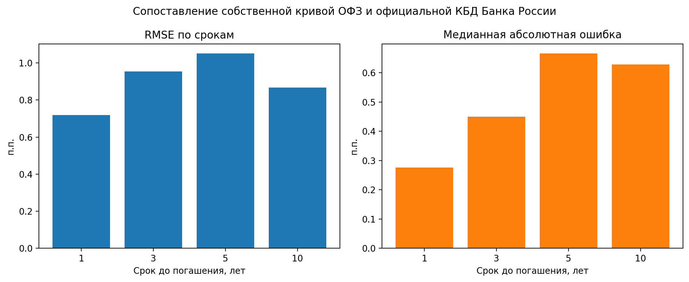
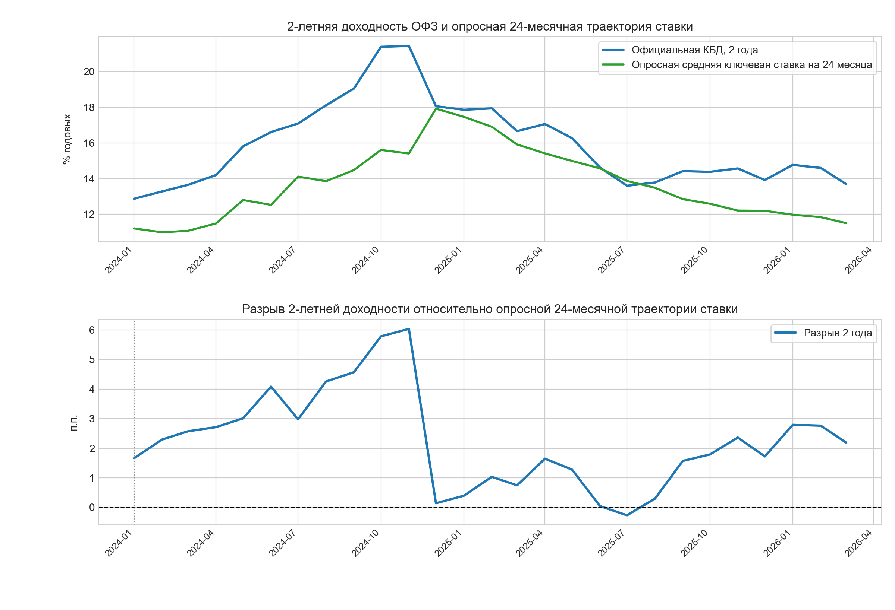

# Моделирование и прогнозирование кривой бескупонной доходности ОФЗ (`Nelson-Siegel`, `VECM`, `ML`)

**Финалист (Топ-10 по России) Всероссийского конкурса ВКР Банка России, РЭШ и НИУ ВШЭ (2026)**

Автор: **Аделя Ляра (Adelya Lyara)** | Пакет `src/ofz_curve` (`Python`) | `statsmodels` | `scikit-learn` | `CatBoost` | `pytest`

---

## Постановка задачи

Кривая бескупонной доходности государственных облигаций (ОФЗ) агрегирует ожидания участников рынка по траектории ключевой ставки, инфляционной компенсации и премии за процентный и фискальный риск. После структурного сдвига февраля 2022 года на российском долговом рынке изменились ликвидность выпусков, уровень ставок и объем первичных размещений Минфина, из-за чего статические дошоковые спецификации теряют устойчивость.

В репозитории собран воспроизводимый исследовательский `Python`-пакет `ofz_curve`, покрытый автотестами `pytest` на выборке **3144+ торговых дней Московской биржи (2012-2026)**, данных официальной КБД и макроэкономических опросов Банка России:

1. **Динамическая калибровка факторов Нельсона-Сигеля (`DNS`)**: ежедневное оценивание уровня (`beta0`), наклона (`beta1`) и кривизны (`beta2`) с подбором параметра затухания `tau1 = 3.6` по вневыборочной сетке и внешней кросс-проверкой на официальной КБД Банка России.
2. **Вневыборочное walk-forward прогнозирование без утечки данных**: сравнение случайного блуждания (`Random Walk`), `NS-AR(1)`, `NS-VAR` (в уровнях и смешанных разностях с макроконтролями `ln(Brent)` и `ln(USD/RUB)`), коинтеграционной `NS-VECM` (ранг Йохансена), а также нелинейных моделей `Random Forest` и `CatBoost` с жесткой очисткой обучающего окна на глубину горизонта прогноза (`j <= i - h`) и проверкой статистической значимости по тесту **Диболда-Мариано (`DM`)**.
3. **Структурные режимы и событийный анализ (`Event Study`)**: сопоставление режимов (`до 02.2022`, переходный `2022-2023`, режим высоких ставок `2024-2026`), оценка высокочастотной реакции наклона кривой на решения Совета директоров Банка России по ключевой ставке и первичные аукционы ОФЗ Минфина, а также расчет разрыва между 2-летней доходностью ОФЗ и 24-месячной опросной траекторией ключевой ставки.

---

## Архитектура пайплайна

```text
Котировки ОФЗ MOEX ISS + Официальная КБД ЦБ РФ + Макроряды и опросы аналитиков (2012-2026)
   |
   +--> [1] Очистка данных и учет лагов публикации (ofz_curve.data_loading, cpi_loaders)
   |        Фильтрация неликвидных бумаг, сдвиг месячной макростатистики на 1 месяц для честного real-time теста
   |
   +--> [2] Ежедневная калибровка Nelson-Siegel и оптимизация tau1 (ns_calibration, tau1_optimization)
   |        Извлечение (beta0, beta1, beta2), сверка с официальной КБД ЦБ РФ (cbr_zero_curve)
   |
   +--> [3] Walk-Forward прогнозирование факторов и доходностей (forecasting, var_tests, ml_models)
   |        Расширяющееся окно с отсечением перекрывающихся таргетов (без data leakage):
   |        Random Walk | NS-AR(1) | NS-VAR | NS-VECM (Johansen) | Random Forest | CatBoost
   |
   +--> [4] Добавочная прогнозная сила и событийный анализ (predictive_power, policy_path_gap,
            key_rate_event_study, ofz_auction_study, long_end_residual)
            Тесты Диболда-Мариано (p < 0.05), премия 2Y ОФЗ к опросу ЦБ РФ, окна решений ЦБ и аукционов Минфина
```

---

## Основные эмпирические результаты

### 1. Внешняя валидация по официальной КБД Банка России (`N = 3144` торговых дня)

На пересекающемся дневном окне (`02.09.2013 - 06.03.2026`) восстановленные по оцененным факторам `Nelson-Siegel` (`tau1 = 3.6`) доходности точно воспроизводят официальную кривую Мосбиржи и Банка России без подгонки под официальные узлы:

| Срок до погашения | Число дней (`N`) | Средняя ошибка, п.п. | Медианная абс. ошибка, п.п. | `RMSE`, п.п. | Корреляция (`r`) |
| :---: | :---: | :---: | :---: | :---: | :---: |
| **1 год** | 3144 | -0.208 | 0.276 | **0.718** | **0.984** |
| **3 года** | 3144 | -0.628 | 0.450 | **0.955** | **0.984** |
| **5 лет** | 3144 | -0.779 | 0.666 | **1.050** | **0.980** |
| **10 лет** | 3144 | -0.538 | 0.629 | **0.866** | **0.971** |



### 2. Вневыборочное прогнозирование кривой доходности (`RMSE`, п.п.) и макрорядов (`Diebold-Mariano`)

На коротком горизонте (`h = 21` торговый день) краткосрочная инерция котировок оставляет преимущество за случайным блужданием (`RW`). На средних и длинных горизонтах (`h = 63, 126, 252` торговых дня) многомерные факторные модели (`NS-VAR`, `NS-VECM`) систематически обыгрывают `RW`, снижая вневыборочную `RMSE` на длинном конце кривой (`10 лет`) на **-1.62 п.п.** (горизонт 6 мес.) и **-1.94 п.п. (-30.2%)** (горизонт 12 мес., `4.47 п.п.` против `6.41 п.п.` у `RW`). В макроэкономическом блоке добавление факторов кривой статистически значимо улучшает прогнозы инфляции и ключевой ставки по тесту **Диболда-Мариано (`p = 0.027 - 0.049 < 0.05`)**, сокращая `RMSE` до **38.2%** по ставке (`h = 6 мес.`) и до **64.7%** по годовой инфляции (`h = 12 мес.`):

| Горизонт (`h`, торг. дней) | Срок | `N` (OOS) | `NS-AR(1)` | `NS-VAR (Level)` | `NS-VAR (Diff/Level)` | `NS-VECM (Johansen)` | `Random Walk` | Выигрыш к `RW` |
| :---: | :---: | :---: | :---: | :---: | :---: | :---: | :---: | :---: |
| **63 дн. (~3 мес.)** | 5 лет | 1003 | 3.052 | 2.802 | **2.777** | 2.808 | 3.042 | **-0.265 п.п.** |
| **63 дн. (~3 мес.)** | 10 лет | 1003 | 2.647 | **2.315** | 2.489 | 2.398 | 3.045 | **-0.730 п.п.** |
| **126 дн. (~6 мес.)** | 5 лет | 940 | 3.790 | 3.673 | **3.449** | 3.577 | 3.788 | **-0.339 п.п.** |
| **126 дн. (~6 мес.)** | 10 лет | 940 | 3.525 | **2.852** | 3.058 | 2.923 | 4.477 | **-1.625 п.п.** |
| **252 дн. (~12 мес.)** | 10 лет | 814 | 5.018 | 4.957 | **4.471** | 4.530 | 6.409 | **-1.938 п.п. (-30.2%)** |

### 3. Рыночная премия 2-летних ОФЗ над 24-месячной опросной траекторией ключевой ставки

Сопоставление 2-летней бескупонной доходности ОФЗ с согласованной по горизонту 24-месячной ожидаемой траекторией ключевой ставки из макроэкономического опроса Банка России выявляет устойчивую положительную премию после 2022 года:

| Режим рынка | Период | Месяцев (`N`) | Средний разрыв, п.п. | Медиана, п.п. | Доля положительных месяцев | `t`-стат. (`p`-value) |
| :--- | :---: | :---: | :---: | :---: | :---: | :---: |
| Переходный (`2022-2023`) | `2022-02` - `2023-12` | 23 | **+1.11 п.п.** | +1.10 п.п. | 82.6% | `t = 3.24` (`p = 0.0019`) |
| Вся послешоковая выборка | `2022-02` - `2026-03` | 50 | **+1.72 п.п.** | +1.61 п.п. | 90.0% | `t = 7.04` (`p < 0.0001`) |
| **Режим высоких ставок (`2024-2026`)** | `2024-01` - `2026-03` | 27 | **+2.24 п.п.** | +2.19 п.п. | **96.3%** | **`t = 7.05` (`p < 0.0001`)** |



Дополнительно событийный анализ показывает, что в режиме `2024-2026` спред наклона `10Y - 1Y` расширяется в среднем на **`+0.16 п.п.` (`+1` день) и `+0.17 п.п.` (`+3` дня)** вокруг заседаний Банка России по ставке и на **`+0.15 п.п.` (`+5` дней)** после крупных аукционов Минфина РФ.

---

## Структура репозитория

```text
ofz-yield-curve-forecasting/
├── src/ofz_curve/              # Устанавливаемый Python-пакет (17 модулей)
│   ├── ns_calibration.py       # Калибровка дневных факторов Нельсона-Сигеля
│   ├── tau1_optimization.py    # Вневыборочный поиск оптимального параметра затухания tau1
│   ├── cbr_zero_curve.py       # Нормализация и сверка с официальной КБД Банка России
│   ├── forecasting.py          # Walk-forward прогнозы AR(1), VAR, VECM и Random Walk
│   ├── ml_models.py            # Random Forest и CatBoost со строгой очисткой горизонта (no leakage)
│   ├── var_tests.py            # Тесты ADF, коинтеграция Йохансена, Грейнджер, FEVD и IRF
│   ├── predictive_power.py     # Макропрогнозы с учетом лагов публикации и тесты Диболда-Мариано
│   ├── policy_path_gap.py      # Оценка премии 2Y ОФЗ к 24-месячному консенсус-опросу ЦБ РФ
│   ├── key_rate_event_study.py # Реакция кривой на решения Банка России по ключевой ставке
│   └── ofz_auction_study.py    # Реакция длинного конца на первичные аукционы ОФЗ Минфина
├── scripts/                    # CLI-скрипты полного воспроизведения расчетов и графиков
├── notebooks/active/           # Аналитические ноутбуки (NS-калибровка, сборка ИПЦ, VECM)
├── data/                       # Исторические выгрузки MOEX/ЦБ РФ и расчетные таблицы
├── assets/                     # Итоговые графики эмпирических блоков
├── tests/smoke/                # Автотесты pytest (калибровка, VECM, event study, контроль утечек)
└── pyproject.toml              # Конфигурация пакета и pytest
```

---

## Быстрый старт и запуск тестов

```bash
python3 -m venv .venv
source .venv/bin/activate
pip install -e .

# Запуск полного набора автотестов (22 теста: калибровка, VECM, event study, отсутствие утечек в ML)
pytest -q
```

Воспроизведение отдельных эмпирических расчетов из командной строки:

```bash
python3 scripts/run_cbr_zero_curve_validation.py
python3 scripts/run_predictive_power.py
python3 scripts/run_policy_path_gap_analysis.py
python3 scripts/run_key_rate_event_study.py
python3 scripts/run_ofz_auction_event_study.py
```

---

## Лицензия

Код распространяется под лицензией [MIT](LICENSE).
